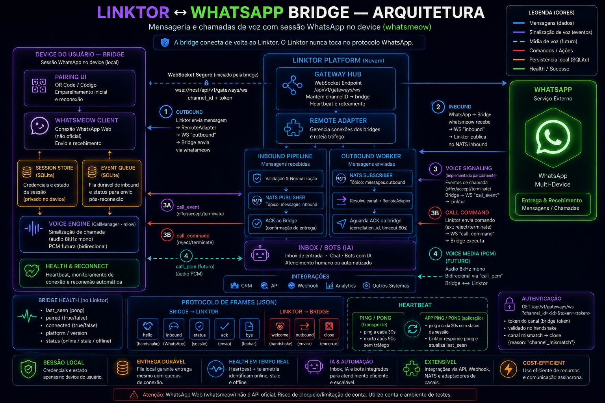

# Linktor Bridge

Bridges de WhatsApp Multi-Device que rodam **no device do usuário** (Android ou
PC Windows/Linux/macOS) e conectam o [Linktor](https://github.com/edsonmartins/linktor)
ao WhatsApp por WebSocket — mantendo a sessão onde o WhatsApp Web já é usado.



## A ideia

O Linktor é uma plataforma omnichannel: inbox unificado, bots/IA, automações e
agentes humanos conversando com clientes por múltiplos canais (Cloud API, SMS,
e-mail, Telegram, RCS). O WhatsApp é, de longe, o canal mais crítico — mas é
também o mais restritivo para integrações não-oficiais.

O WhatsApp correlaciona o dispositivo vinculado pelo **IP e localização**.
Sessões `whatsmeow` rodando em datacenter nascem em um IP "estranho" e são
frequentemente interpretadas como anomalia e bloqueadas. A bridge resolve isso
com uma inversão de arquitetura:

> **A sessão WhatsApp não vive no servidor. Vive no device do usuário.**
> A ponte é o canal: o Linktor fala com a bridge, e a bridge fala com o WhatsApp.

O resultado:

- **Mesma localização física** do uso legítimo do WhatsApp Web → menor risco de
  bloqueio/ban.
- **Sessão privada**: identidade e chaves ficam no armazenamento local do
  usuário (SQLite), nunca no servidor.
- **O servidor nunca toca o protocolo WhatsApp** — apenas troca mensagens
  estruturadas com a bridge por WebSocket autenticado.

## Onde se aplica

- **Empresas que já usam o Linktor** e precisam de WhatsApp sem Cloud API
  (custo, indisponibilidade ou política da Meta).
- **Operações com atendimento humano via WhatsApp** onde o dono da linha (CNPJ
  ou pessoa) mantém o número no celular/PC e quer centralizar no Inbox.
- **Hospedagem on-premise / VPS própria** (o device da bridge pode ser um
  mini-PC ou máquina virtual no mesmo datacenter regional).
- **Ambientes de teste/staging**: linhas de teste pareadas em dispositivos
  descartáveis, sem depender de número de produção.

## Fluxo de mensagens

```text
[ Device do usuário ]                          [ Servidor Linktor ]
┌────────────────────────────┐                 ┌─────────────────────────────┐
│ bridge (Android ou PC)     │                 │ plataforma (inbox, bots, IA)│
│  whatsmeow.Client ◄───────┐ │  WS + token    │ gateway endpoint (WS)       │
│  store SQLite (local)     │ │◄──────────────►│  RemoteAdapter → outbound   │
│  UI pareamento QR/código  │ │   inbound/     │  NATS linktor.messages.*    │
└────────────────────────────┘ │   status      └─────────────────────────────┘
                               └──────────────►
```

- **Inbound** (WhatsApp → Linktor): a bridge recebe a mensagem, persiste no
  store local (entrega durável) e publica no subject
  `linktor.messages.inbound.whatsapp` — consumido pelo pipeline já existente.
- **Outbound** (Linktor → WhatsApp): o `RemoteAdapter` no servidor envia um
  comando pelo WS e aguarda ack com `message_id`; a bridge executa
  `wacore.SendText*` e confirma.
- **Chamadas**: só a sinalização trafega (`call_event` com oferta, aceite,
  recusa e término; `call_command` para recusar). O áudio toca e é atendido no
  aparelho pareado; o Linktor registra a chamada na conversa e pode recusá-la.
- **Health**: `ping`/`pong` de aplicação + `bridge_health` no Channel
  (online/stale) para o Linktor saber se o canal está operante.

## Estrutura

```text
linktor-bridges/
├── go/                              # módulo Go compartilhado
│   ├── wacore/                      # core único autorizado a importar whatsmeow
│   │   ├── core.go                  #   pairing QR/código, connect, send, inbound
│   │   └── core_test.go
│   ├── agent/                       # cliente WS do protocolo bridge↔Linktor
│   │   ├── agent.go                 #   hello/outbound/ack/inbound/status/ping
│   │   └── agent_test.go            #   testes contra servidor WS mockado
│   ├── eventstore/                  # fila durável (SQLite) para eventos inbound
│   │   └── store.go
│   └── cmd/bridge-desktop/          # app desktop (system tray + web local)
│       └── webui/index.html         #   dashboard embutido (go:embed)
├── android/                         # app Android (compõe o AAR via gomobile)
│   ├── app/src/main/java/dev/whatsbridge/
│   │   ├── MainActivity.kt          #   UI de status/pareamento/envio
│   │   └── wa/WaGateway.kt          #   wrapper JNI sobre wacore
│   └── settings.gradle.kts
├── docs/
│   ├── PROTOCOL.md                  # contrato WS bridge↔Linktor
│   └── linktor_bridges_diagrama.png # diagrama de arquitetura
├── scripts/build-aar.sh             # gera android/app/libs/wacore.aar
└── README.md
```

## Como rodar

### Desktop (Windows/Linux/macOS)

```bash
cd go
go run ./cmd/bridge-desktop
# store: ~/.linktor/linktor-bridge/
# dashboard: http://127.0.0.1:<porta>
```

Conectando a um Linktor:

```bash
go run ./cmd/bridge-desktop \
  --server wss://linktor.example.com/api/v1/gateways/ws \
  --channel-id wh-abc123 \
  --token <bridge-token>
```

**Entrega durável de eventos**: mensagens recebidas (inbound) são persistidas
num store SQLite local (`~/.linktor/linktor-bridge/events.db`) antes de serem
enviadas ao gateway. Se a conexão cair, os eventos ficam enfileirados no device
e são reenviados quando a conexão volta — sem perda por outage longo do link.

Builds:

```bash
# macOS (exige cgo para a bandeja nativa — rodar na própria máquina ou CI macOS)
CGO_ENABLED=1 go build -o bin/bridge-darwin-arm64 ./cmd/bridge-desktop

# Windows (pure-Go)
GOOS=windows GOARCH=amd64 CGO_ENABLED=0 go build -o bin/bridge-windows-amd64.exe ./cmd/bridge-desktop

# Linux (exige cgo/X11 para a bandeja — buildar no alvo ou container)
GOOS=linux GOARCH=amd64 CGO_ENABLED=1 go build -o bin/bridge-linux-amd64 ./cmd/bridge-desktop
```

### Configuração (painel ou flags)

Na primeira execução o bridge sobe sem ligação com o Linktor e o painel pede
três campos no bloco **Linktor**: a URL do gateway (`wss://host/api/v1/gateways/ws`),
o ID do canal `whatsapp_remote` e o token gerado em
`POST /api/v1/channels/:id/bridge-token`. Ao salvar, ele grava
`~/.linktor/linktor-bridge/config.json` (permissão `0600`) e liga na hora; nas
execuções seguintes lê o arquivo e liga sozinho. Os flags `--server`,
`--channel-id` e `--token` continuam valendo, sobrepõem o arquivo e também são
gravados nele.

O painel escuta em `127.0.0.1:7788` por padrão (`--listen` ou `"listen"` no
`config.json` trocam; se a porta estiver ocupada ele avisa e usa uma livre). O
bloco Linktor mostra se o bridge está de fato conectado ao gateway, separado
do estado do WhatsApp. **Desconectar e esquecer** apaga a ligação com o Linktor
sem desparear o WhatsApp.

### Sem bandeja (Linux sem GTK/cgo, servidores, CI)

```bash
CGO_ENABLED=0 go build -tags notray -o linktor-bridge ./cmd/bridge-desktop
./linktor-bridge            # painel em http://127.0.0.1:7788; configure o Linktor por lá
```

Com `-tags notray` a bandeja fica de fora e o binário é 100% Go: o painel
continua em `127.0.0.1:<porta>` (a URL sai no terminal), o monitor de status
loga as mudanças e Ctrl+C encerra. Notificações nativas seguem funcionando onde
houver `notify-send`/D-Bus.


> A bandeja usa `getlantern/systray` (AppKit no macOS, X11 no Linux, nativo no
> Windows), por isso só o Windows tem build 100% pure-Go. O restante do binário
> (whatsmeow, sqlite modernc) é pure-Go — o cgo é apenas da bandeja.

### Android

```bash
export ANDROID_HOME=/caminho/para/Android/sdk
./scripts/build-aar.sh                  # gera android/app/libs/wacore.aar
./gradlew -p android :app:assembleDebug # o wrapper fica na raiz; o projeto Gradle, em android/
```

Instale `android/app/build/outputs/apk/debug/app-debug.apk` no aparelho.

## Validação

```bash
cd go
gofmt -w .
go test ./...
go vet ./...
go build ./cmd/bridge-desktop
```

## Próximos passos

### Feito

- [x] Protocolo bridge↔Linktor (`docs/PROTOCOL.md`) + cliente `agent` com testes
- [x] Endpoint WS no Linktor (`/api/v1/gateways/ws`) + `RemoteAdapter`
- [x] Heartbeat de aplicação (`ping`/`pong`) + saúde da bridge no Linktor
  (`GET /api/v1/channels/:id/bridge-health` e `bridge_health` no Channel)
- [x] `sender_name` (pushName) propagado no inbound
- [x] Store durável de eventos na bridge (`eventstore`, SQLite local)
- [x] Notificação nativa + tooltip no tray quando a bridge desconecta
- [x] Chamadas: `call_event`/`call_command` (sinalização e recusa; sem áudio)

### Roadmap

- [x] **Mídia**: imagem/vídeo/áudio/documento nos dois sentidos (`media` no
  `outbound`, `attachments[]` no `inbound`; figurinha chega como imagem e voz
  como áudio `ptt`). Inbound é baixado no device e re-hospedado no store do
  Linktor; acima de 32 MB só o registro segue
- [x] **Registrar canal + token no Linktor**: canal "WhatsApp via Bridge" no
  admin, com token e saúde do bridge
- [ ] **Mensagem de voz a partir de outros formatos**: transcodificar para
  OGG/Opus antes de enviar (hoje áudio de outro formato sai como arquivo)
- [ ] **Interativos**: botões/listas native-flow sobre a bridge
- [ ] **Voz com mídia**: streaming PCM 16k bridge↔Linktor (engine na bridge)
- [ ] **Teste E2E ao vivo**: parear device real → enviar por
  `POST /api/v1/conversations/:id/messages` → confirmar no Inbox
- [ ] Bridge Android: agent completo via AAR (inbound/outbound/heartbeat)
- [ ] Instaladores desktop (MSI/dmg/deb) + autostart na bandeja
- [ ] Reconexão do embedded whatsmeow não sobrescrever `RemoteAdapter` (race)

## Contribuição

Contribuições são bem-vindas! Antes de abrir um PR, leia o [guia de contribuição](CONTRIBUTING.md): ele cobre ambiente, validação, padrão de commits e a assinatura DCO (`git commit -s`).

## Licença

[Apache License 2.0](LICENSE)

> **Aviso:** `whatsmeow` implementa o protocolo WhatsApp Web/Multi-Device e não é
> API oficial da Meta. Use contas/números de teste. Risco operacional existente.
